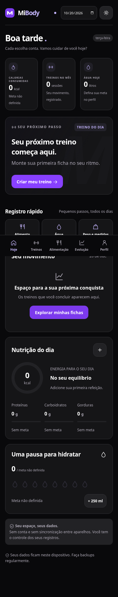

# MiBody

PWA pessoal em português do Brasil para treinos, alimentação e evolução corporal. Sem conta, backend, anúncios ou rastreadores. Os dados e fotos ficam no IndexedDB deste navegador.

Identidade visual em roxo, preto e branco, com temas escuro e claro.

## Abrir o aplicativo baixado

Baixe o ZIP pelo GitHub e **extraia a pasta inteira** antes de abrir. O arquivo `MiBody.html` é uma versão autocontida com código, estilos e ícones embutidos; não exige instalar Node ou executar um servidor. O `index.html` local direciona para esse arquivo. Abrir o código-fonte pela página de arquivos do GitHub não executa o aplicativo.

O uso de arquivos locais e IndexedDB depende das permissões do navegador. Navegadores gerenciados podem bloquear `file:`. Os dados não ficam dentro do HTML nem acompanham o arquivo: faça backups no Perfil. Para instalar no celular como PWA, use o site HTTPS; a versão em arquivo único não instala service worker e não oferece instalação. O build regenera `dist/MiBody.html`. Ao alterar o código, execute também `npm run export:portable` para atualizar e versionar `MiBody.html` na raiz.

## Interface



## Executar

Requer Node.js 20.19+ ou 22.12+ (validado com Node 24) e npm.

```sh
cd /workspace/MiBody
npm ci --cache /tmp/mibody-npm
npm run dev
```

Abra o endereço informado pelo Vite no navegador do computador. O modo de desenvolvimento não registra o service worker: para testar offline ou instalação, use o build de produção.

```sh
npm run build
npm run preview -- --port 4173
```

## Hospedar e instalar no celular

1. Execute `npm ci` e `npm run build`.
2. Publique **todo o conteúdo de `dist/`** em uma hospedagem estática com HTTPS. O build padrão usa a raiz do domínio; para um subdiretório, use `MIBODY_BASE=/MiBody/ npm run build`. Não é necessário servidor de aplicação nem variáveis secretas. Exemplos possíveis: GitHub Pages, Netlify ou Cloudflare Pages.
3. Configure `sw.js` e `index.html` para revalidação (`Cache-Control: no-cache`). Os arquivos com hash em `assets/` podem receber cache imutável. Não remova arquivos antigos durante uma sessão ativa; ao atualizar, feche todas as janelas do app e reabra para ativar o novo cache.
4. Abra o site no celular com internet e aguarde o primeiro carregamento completo.
5. Android/Chrome: menu → **Instalar aplicativo**. No Perfil, o botão aparece somente se o navegador emitir o evento de instalação.
6. iPhone/Safari: Compartilhar → **Adicionar à Tela de Início**. Não há botão programático de instalação no Safari.
7. Depois do primeiro carregamento em HTTPS, o app e os registros funcionam sem internet. Um endereço HTTP de rede local não oferece os mesmos recursos de instalação e service worker; `localhost` é uma exceção apenas para desenvolvimento.

### Publicação no GitHub Pages

O workflow `.github/workflows/pages.yml` está preparado para compilar, testar e publicar o projeto após um envio à branch `main`. Ele usa o caminho do repositório, como `/MiBody/`. O workflow só será executado no GitHub após o envio do código; preparar esses arquivos localmente não publica o aplicativo.

No repositório GitHub, em **Settings → Pages → Build and deployment**, escolha **GitHub Actions** como origem. Essa configuração exige acesso de administração e disponibilidade do Pages para o plano e a visibilidade do repositório. Depois, acompanhe o workflow em **Actions**. O endereço efetivo aparecerá no resultado da etapa de publicação. Não há um endereço ativo enquanto essa publicação não concluir.

Para validar localmente o mesmo caminho antes de publicar:

```sh
MIBODY_BASE=/MiBody/ npm run build
MIBODY_BASE=/MiBody/ npm run preview -- --port 4174
# Em outro terminal:
APP_URL=http://localhost:4174/MiBody/ npm run test:e2e
```

## Usar

- **Hoje:** escolha a data, acompanhe seu dia e registre alimento, água ou medidas.
- **Treinos:** crie uma ficha, adicione exercícios personalizados ou da biblioteca e associe dias da semana. Não há ficha prescrita automaticamente. Duplicar, editar, ordenar, arquivar e excluir preserva o histórico.
- **Sessão:** campos vazios mostram referências. Digite carga real (inclusive `0` para exercício sem peso) e repetições, e marque cada série. Carga × repetições só entra no volume se a série estiver concluída. Tempos e descanso usam timestamps e sobrevivem ao recarregamento; pausas são descontadas da duração ativa.
- **Alimentação:** cadastre nutrientes do rótulo por g, ml ou porção. O consumo usa a mesma unidade e é proporcional à referência. Cadastre receitas com ingredientes e rendimento em porções. O plano não entra no diário até você registrar o consumo. Registros mantêm uma cópia dos nutrientes de quando foram criados.
- **Evolução:** peso, medidas e fotos são opcionais. Gráficos, frequência, comparações e recordes usam somente registros reais.
- **Perfil:** edite metas, tema, descanso automático e o atalho de água. Metas não são prescritas pelo app.

### PPL + Upper + Lower com máquinas

Em **Treinos → Ver divisão**, revise e adicione cinco fichas opcionais de exemplo: Push, Pull, Legs, Upper e Lower. Elas usam máquinas com pino seletor e polias, com cargas em branco e dias opcionais. Séries, repetições e descansos são referências editáveis; não são uma prescrição individual. O [guia da divisão](docs/ppl-maquinas.md) lista a sequência completa.

Em **Perfil → Prioridade de equipamentos**, escolha “Máquinas e polias primeiro”. A biblioteca inclui aparelhos comuns, com notas para regulagem. Bibliotecas e históricos anteriores são preservados, e a importação das fichas não duplica exemplos já adicionados. No treino, **Substituir** oferece filtros de equipamento e movimento; séries já concluídas ficam no exercício original e a alternativa começa sem carga registrada.

### Exemplo de alimentação econômica

Em **Alimentação → Meu plano alimentar → Ver exemplo econômico**, revise quatro refeições com alimentos comuns. Os valores dos dez alimentos são uma seleção estática da **TACO, NEPA/UNICAMP, 4ª edição, 2011**, com referência em 100 g. O aplicativo não consulta serviços nutricionais durante o uso. O [guia e a procedência dos dados](docs/alimentacao-economica.md) explicam o exemplo e suas limitações.

A importação adiciona itens ao planejamento, preservando consumos anteriores e as metas atuais. O usuário pode optar expressamente por usar metas arredondadas a partir dos totais do exemplo. Não há cálculo automático de necessidades pessoais. Repetir a importação não duplica os itens. As anotações de alergias e restrições no Perfil ficam localmente no IndexedDB e entram no backup; o app não certifica ingredientes como seguros para alergias.

### Variar o cardápio por data

Em **Alimentação → Opções de cardápio**, há dez combinações: duas vitaminas para café da manhã/lanche e oito refeições principais com arroz, feijão, frango grelhado, ovos, macarrão com molho de tomate, batata e batata-doce. Use os filtros, abra **Ver e escolher**, ajuste as quantidades e escolha a data e a refeição. O total nutricional acompanha as alterações. As opções têm totais diferentes; não representam trocas nutricionalmente equivalentes.

A escolha substitui somente a refeição da data indicada e mantém as outras refeições do plano vigente. O **Plano padrão** continua sendo usado nas datas sem cardápio próprio; os cardápios personalizados têm cópias independentes e não mudam quando o padrão é editado. Em **Meu plano alimentar**, navegue entre os dias, copie um cardápio para outra data ou volte ao padrão com confirmação. O consumo do diário continua separado. Itens das refeições e seus nutrientes ficam salvos no aparelho e entram no backup; backups antigos da versão 1 continuam aceitos.

As vitaminas usam os rótulos de leite em **ml** e whey em **g**, cadastrados pelo usuário na própria tela da opção e reutilizados nas próximas escolhas. Não há nutrientes de marcas presumidos nem conversão de g para ml. Os 30 g de whey são uma quantidade inicial de pó, ajustável conforme o produto. Para macarrão e patinho, as referências usam **massa seca e carne crua**, com indicação em cada ingrediente; os outros alimentos seguem o estado descrito. A [documentação dos alimentos](docs/alimentacao-economica.md) detalha a procedência.

## Dados e recuperação

Cada alteração de registros é gravada automaticamente no IndexedDB. Em caso de falha, uma faixa de erro permanece visível. Exporte um backup antes de sair caso isso aconteça. Não há sincronização entre celulares, entre navegadores ou entre o navegador e uma instalação que use outro espaço de armazenamento.

**Perfil → Backup completo (JSON)** exporta registros, fichas, alimentos, receitas, configurações, sessão em andamento e fotos. Guarde esse arquivo de forma privada: ele contém seus dados em texto e imagens, sem criptografia. **Restaurar backup** verifica a versão e a estrutura e pede confirmação antes de substituir os dados atuais. A versão aceita é `1`. O CSV inclui alimentos consumidos, séries, água e medidas; ele não substitui o backup completo.

Limpar dados do navegador ou trocar de aparelho pode apagar os registros locais. O pedido de armazenamento persistente depende do navegador e não dispensa backups. Fotos aceitam JPEG, PNG ou WebP até 8 MB por arquivo; backups até 100 MB. Nenhuma foto é enviada para análise externa.

## Validação

```sh
npm test
npm run build
# Em outro terminal, deixe npm run preview -- --port 4173 executando:
npm run test:e2e
npm run test:portable
npm run test:machines
npm run test:budget
npm run test:menus
```

O teste de navegador usa Chromium instalado em `/usr/bin/chromium`; outro caminho pode ser passado em `CHROMIUM_PATH`. Os testes usam um perfil temporário e não alteram seus dados pessoais. Capturas são geradas em `test-results/`, que não é versionado.

Os testes cobrem cálculos, validação de backup, snapshots do histórico, fluxo de treino, recuperação, relógio, alimentação, plano separado, backup/restauração, medidas, gravação offline e larguras móveis e desktop. A instalação e os alertas em Android/iPhone físicos ainda exigem validação nesses dispositivos.

A versão autocontida foi testada em HTTP sem requisitar dependências externas, incluindo persistência, treino e backup. O redirecionamento do `index.html` local é testado separadamente. A execução direta via `file:` não pôde ser validada neste ambiente, cujo navegador gerenciado bloqueia esse protocolo.

## Limites explícitos

- Não há sincronização, login, base nutricional externa, leitor de código de barras, reconhecimento de foto ou prescrição de dieta/treinos.
- Descanso tenta emitir som/vibração apenas com o app aberto e suporte do navegador. Não há push, execução garantida em segundo plano nem alertas com o app fechado. Ao voltar ao app, o horário é recalculado.
- As séries registram repetições inteiras e carga em kg; exercícios cronometrados podem usar observações, mas não têm um campo próprio de duração da série.
- O app foi validado em Chromium. Compatibilidade de instalação e comportamentos específicos do Safari precisam de teste em dispositivo real.
- Hospedagem HTTPS e publicação não foram feitas pelo projeto.

## Organização

- `src/core.js`: cálculos, criação de sessões, datas, CSV e validação de backup.
- `src/machines.js`: catálogo de máquinas, divisão PPL + Upper + Lower e importação sem duplicidade.
- `src/budget.js` e `src/budget-foods.json`: exemplo econômico e valores nutricionais com procedência, separados do diário consumido.
- `src/menus.js` e `src/menu-foods.json`: opções de refeições, referências adicionais TACO e cardápios independentes por data.
- `src/db.js`: transações IndexedDB.
- `src/app.js`: telas, formulários, navegação e interações.
- `src/style.css`: temas, layout responsivo e acessibilidade visual.
- `vite.config.js`: build e geração do service worker com cache dos arquivos da versão.
- `public/`: manifesto e ícones locais.
- `tests/`: testes unitários e fluxos reais no navegador.
